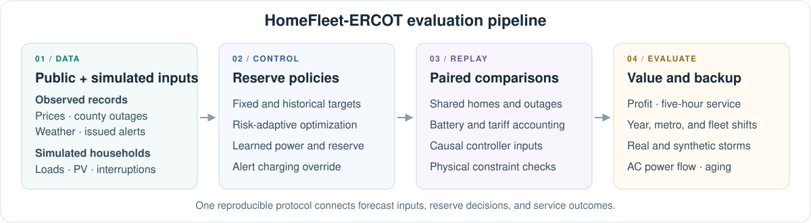
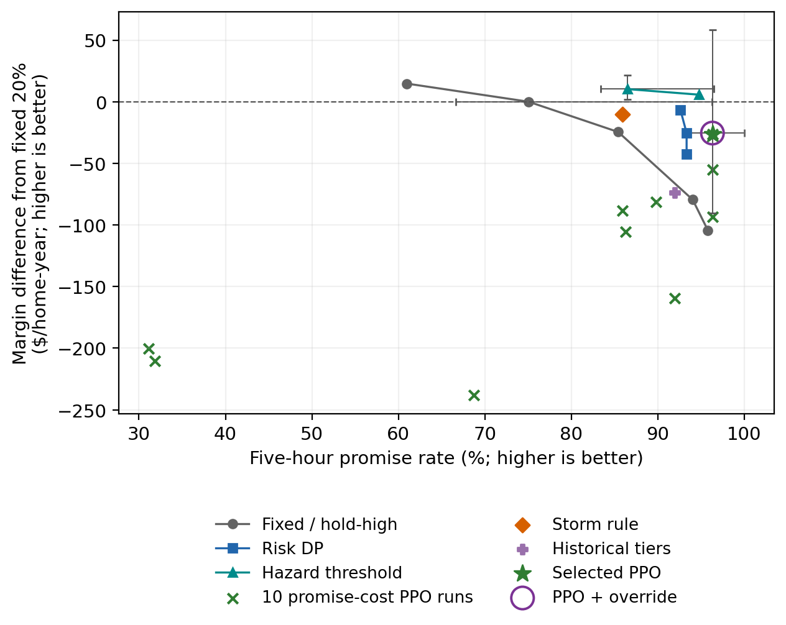
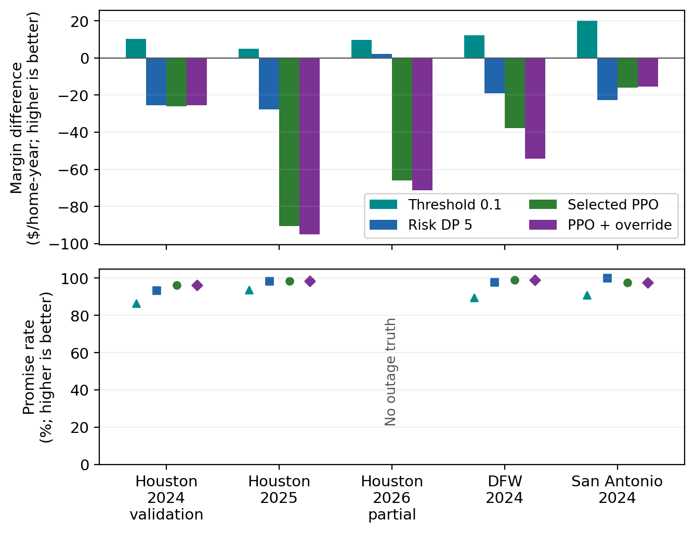

<div align="center">

<h1>Adaptive Reliability Reserves<br>for Residential Battery Fleets</h1>

<p><strong>HomeFleet-ERCOT · Official code and benchmark</strong></p>

<p>
Maruthi Vemula<sup>1</sup> &nbsp; · &nbsp; Neeraj Praneeth Gajula<sup>2</sup><br>
<sup>1</sup>University of North Carolina at Chapel Hill &nbsp; <sup>2</sup>New York University
</p>

<p>
<a href="https://github.com/MaruthiV/homefleet/releases/download/preprint-2026-11-17/adaptive-reliability-reserves.pdf"></a>
<a href="https://github.com/MaruthiV/homefleet/releases/tag/v0.2.0"></a>
<a href="https://github.com/MaruthiV/homefleet/actions/workflows/tests.yml"></a>
<a href="pyproject.toml"></a>
<a href="LICENSE"></a>
</p>

<p>
<a href="#overview">Overview</a> ·
<a href="#main-results">Results</a> ·
<a href="#quick-start">Quick start</a> ·
<a href="#data-and-checkpoints">Data &amp; checkpoints</a> ·
<a href="#reproducing-the-paper">Reproduction</a> ·
<a href="#citation">Citation</a>
</p>

</div>

## Overview

**How much market value can residential batteries retain while protecting household backup?**

HomeFleet-ERCOT is an open benchmark for studying this tradeoff. It combines observed ERCOT prices and county outage records with simulated households, compares fixed, risk-adaptive, and learned reserve policies, and evaluates how their economics and backup service change across years, metropolitan areas, fleets, and storms.

<p align="center">
  <a href="assets/overview.svg"></a>
</p>

The release provides individual household profiles, causal forecast inputs, controller implementations, **21 trained PPO checkpoints**, and the complete paired evaluation grid. Static AC power-flow and battery-aging analyses examine consequences beyond the dispatch objective.

<details>
<summary><strong>Paper abstract</strong></summary>

In a Houston 2024 replay, replacing a fixed 20% battery reserve with a county-risk threshold raises observed five-hour backup coverage from 75.0% to 86.5% and adds USD 10.2 in modeled annualized margin per home (paired 95% interval: USD +1.7 to USD +21.7). The paired coverage-gain interval includes zero. This is a conditional simulation result, not measured company reliability. Residential batteries face this tradeoff because market discharge consumes energy also needed for household outages. We release HomeFleet-ERCOT, combining observed prices and county outages with identified simulated homes and causal controller inputs. We compare independent-home optimization with 21 proximal policy optimization (PPO) training runs; ten promise-cost candidates span 31.1%-96.3% backup coverage. Of these, 10 have lower modeled margin than fixed 20%, and 3 also have lower coverage. Chronological, geographic, fleet, and storm tests examine transfer. An alert charging override has a conditional energy-and-power sufficiency guarantee, but only 19.5% of 41 county mass-outage episodes provide enough continuous warning for every battery preset. Synthetic tests include short, missed, and false warnings, load uplift, capacity loss, and dropout. A static AC audit retains existing feeder violations; aging comparisons expose model sensitivity. The released benchmark, controllers, and checkpoints provide a reproducible basis for comparing these tradeoffs. This work supports the design of residential battery programs that assess market value and household backup service together.

</details>

## Updates

- **2026-11-17:** The [named preprint and TeX source](https://github.com/MaruthiV/homefleet/releases/tag/preprint-2026-11-17) are available with the final abstract.
- **2026-11-17:** [Release v0.2.0](https://github.com/MaruthiV/homefleet/releases/tag/v0.2.0) includes frozen inputs, all trained checkpoints, complete results, and an installable wheel.

## Main results

<p align="center">
  <a href="paper/figs/frontier.png"></a>
</p>

**Houston 2024.** Higher values on both axes are preferable. Margin is measured relative to a fixed 20% reserve, with terminal inventory adjustment. The figure includes all ten promise-cost PPO candidates; error bars show paired window-bootstrap intervals for the indicated policies.

<!-- GENERATED_HEADLINE_START -->

In the corrected Houston 2024 replay, the threshold 0.1 reserve raises simulated backup coverage from **75.0% to 86.5%** and adds **USD 10.2 in modeled margin per home-year** (paired 95% interval: USD 1.7–21.7). Coverage means serving the first five hours or until earlier restoration. The paired interval for the coverage gain includes zero, and the 2025 replay yields higher margin with lower observed coverage. These are conditional simulation comparisons.

Across the 10 promise-cost PPO runs in that replay, backup coverage ranges from **31.1% to 96.3%**; **10 of 10** have lower modeled margin than fixed 20%. [The complete results table](artifacts/summary.csv) retains the full values and intervals.

<!-- GENERATED_HEADLINE_END -->

<details>
<summary><strong>Transfer, warning limits, and system consequences</strong></summary>



Controller choices are fixed using Houston 2024 before chronological and geographic evaluation. Adaptive reserves do not improve economics and backup service together in every setting. The 2026 split supports market comparisons only because it has no observed outage truth.

The alert charging override has explicit energy, power, availability, and continuous-warning conditions. Real warning coverage and synthetic short, missed, and false alerts test those conditions. The static AC audit retains existing feeder violations; aging comparisons expose sensitivity to the chosen battery model. See the [paper](paper/main.pdf) and [complete result tables](artifacts/summary.csv) for the findings and their scope.

</details>

## Quick start

Use **Python 3.12**. The included example runs without a data download, API key, or PyTorch installation.

```bash
git clone https://github.com/MaruthiV/homefleet.git
cd homefleet
python3.12 -m venv .venv
source .venv/bin/activate
python -m pip install -e .
python -m homefleet.demo --check
```

The example compares fixed and hazard-threshold reserves on a two-day Houston Beryl replay for eight simulated homes. It reports modeled margin, five-hour backup service, unserved energy, and physical constraint checks. A successful run ends with:

```text
Reference results match.
```

Both `physical_violations` and `reachable_floor_violations` should be zero. The reported weekly margin is a rate over the two-day example.

## Data and checkpoints

All research artifacts are available in [release v0.2.0](https://github.com/MaruthiV/homefleet/releases/tag/v0.2.0). The downloader checks each archive against the [SHA-256 manifest](artifacts/release_manifest.json) before extraction.

| Artifact | Contents | Download |
| --- | --- | --- |
| Replay bundles | 22 metro/year bundles with 300 simulated home profiles per metropolitan pool | [618.6 MB](https://github.com/MaruthiV/homefleet/releases/download/v0.2.0/homefleet-bundles-v0.2.0.tar.gz) |
| Source caches and risk models | Cached market, outage, weather, warning, building, and feeder inputs; fitted county-risk model | [257.0 MB](https://github.com/MaruthiV/homefleet/releases/download/v0.2.0/homefleet-raw-v0.2.0.tar.gz) |
| Trained checkpoints | All 21 PPO runs, configurations, and training logs | [12.4 MB](https://github.com/MaruthiV/homefleet/releases/download/v0.2.0/homefleet-checkpoints-v0.2.0.tar.gz) |
| Evaluation results | 473 main evaluation CSVs, completion records, summaries, and ancillary analyses | [4.1 MB](https://github.com/MaruthiV/homefleet/releases/download/v0.2.0/homefleet-results-v0.2.0.tar.gz) |

```bash
python scripts/download_data.py --group all
```

Use `--group bundles`, `raw`, `checkpoints`, or `results` to download an individual group. Bundles are sufficient for controller evaluation; the source caches and fitted models support input rebuilding and the full manuscript analysis.

**Data provenance.** Prices and county outage records are observed; household loads, PV, and individual interruptions are simulated. County records do not identify outages for the sampled buildings. The [data card](docs/DATA_CARD.md) documents each field, transformation, assumption, and source license.

## Reproducing the paper

The experiments use **v0.2.0 / causal-v3**. From the repository root, install the locked research environment and reproduce the checked summaries and paper figures:

```bash
python -m pip install -r requirements-lock.txt
python -m pip install --no-deps -e .
python scripts/download_data.py --group all
python scripts/verify_data.py
python scripts/verify_results.py --full
python scripts/summarize_revision.py
python scripts/build_paper_results.py
```

The lock records the tested macOS ARM64 Python 3.12 environment. For a portable research installation, use `python -m pip install -e '.[research,dev]'`; the [reproduction guide](docs/REPRODUCIBILITY.md) explains platform differences, fitted-model compatibility, and the separate BLAST-Lite environment.

<details>
<summary><strong>Retrain and evaluate the full controller grid</strong></summary>

```bash
python scripts/reproduce.py baselines --workers 3
python scripts/reproduce.py train --workers 4
python scripts/reproduce.py policies --workers 4
```

These CPU sweeps resume completed work. The grid includes 21 training runs and guarded/unguarded learned-policy evaluations on eleven datasets. Policy selection uses Houston 2024 only; test years and named event windows do not select the checkpoint. Configurations, source hashes, and training progress are recorded alongside each checkpoint.

<!-- GENERATED_COMPUTE_START -->

Reference training used an ARM64 CPU workstation with 11 logical processors and 18 GiB RAM, up to 6 concurrent training workers, and 1 PyTorch thread per run. Recorded training-loop wall times sum to **15.3 hours across all 21 runs**, excluding startup. This sum differs from elapsed time when runs execute in parallel. The checkpoint archive retains each run's configuration and training log; inference/evaluation timings are reported separately.

<!-- GENERATED_COMPUTE_END -->

See the [full protocol](docs/REPRODUCIBILITY.md#complete-experiment-grid) for the seed/penalty grid and the [ancillary analysis commands](docs/REPRODUCIBILITY.md#stress-tests-system-consequences-and-figures) for fleet changes, synthetic warnings, AC power flow, aging, and runtime.

</details>

### Documentation

| Resource | What it covers |
| --- | --- |
| [Reproduction guide](docs/REPRODUCIBILITY.md) | Environments, full training/evaluation commands, source rebuilding, and manuscript build |
| [Data card](docs/DATA_CARD.md) | Observed and simulated fields, provenance, assumptions, and reuse terms |
| [Experiment manifest](artifacts/experiment_manifest.json) | Exact datasets, controllers, windows, and required result files |
| [Revision notes](docs/REVISION_NOTES.md) | Scientific corrections and differences from the original workshop submission |
| [Release validation](artifacts/public_release_validation.json) | Public downloads, package checks, input reconstruction, and replay verification |

The paper reports conditional simulation comparisons. Prices are exogenous; annualized results combine replay windows initialized at 90% charge. Fixed penalties do not enforce household-specific reliability budgets. The [paper's discussion](paper/main.pdf) sets out the implications for interpreting reliability, grid feasibility, and deployment.

<details>
<summary><strong>Repository structure</strong></summary>

| Path | Contents |
| --- | --- |
| [`src/homefleet/`](src/homefleet/) | Data loaders, battery/outage simulation, control policies, PPO, and evaluation |
| [`configs/`](configs/) | Hardware, tariffs, event splits, and the frozen experiment grid |
| [`scripts/`](scripts/) | Artifact downloads, experiment sweeps, audits, aggregation, and paper builds |
| [`artifacts/`](artifacts/) | Compact result tables, manifests, and verification reports |
| [`paper/`](paper/) | Named preprint, TeX source, and generated figures/tables |
| [`tests/`](tests/) | Causality, accounting, feasibility, solver, and aggregation checks |

</details>

## Citation

If you use HomeFleet-ERCOT or its findings, please cite the paper and identify the artifact release used:

```bibtex
@misc{vemula2026homefleet,
  title = {Adaptive Reliability Reserves for Residential Battery Fleets},
  author = {Vemula, Maruthi and Gajula, Neeraj Praneeth},
  year = {2026},
  howpublished = {Preprint and research code, version 0.2.0},
  url = {https://github.com/MaruthiV/homefleet}
}
```

[CITATION.cff](CITATION.cff) supplies the machine-readable software citation.

## License and acknowledgments

Authored code is [MIT licensed](LICENSE). Third-party inputs and software retain their source terms; see [NOTICE](NOTICE) and the [data card](docs/DATA_CARD.md). HomeFleet-ERCOT builds on public market, outage, building, weather, warning, and feeder datasets, with source attribution documented in the paper and data card.

Questions or reproducibility issues are welcome through [GitHub Issues](https://github.com/MaruthiV/homefleet/issues). Please include the release, command, Python version, and relevant output.
